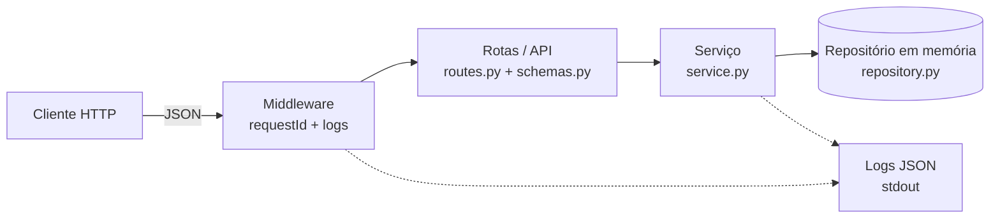

# API de Pedidos — CP5 Arquitetura Orientada a Serviço

FIAP 3ESPY — Profa. Damiana Costa — 21/10/2026

## Integrantes

| Nome                                    | RM       |
|-----------------------------------------|----------|
| Felipe Cerboncini Cordeiro              | RM554909 |
| Pedro Henrique Martins Alves dos Santos | RM558107 |
| Milena Codinhoto da Silva               | RM554682 |

## Tecnologias

- **Linguagem:** Python 3.10+
- **Framework:** FastAPI (+ Uvicorn)
- **Testes:** pytest + TestClient
- **Persistência:** dicionário em memória (os dados se perdem ao reiniciar)

## Como executar

```bash
python -m venv .venv
source .venv/bin/activate        # Windows: .venv\Scripts\activate
pip install -r requirements.txt

# subir a API (http://localhost:8000)
python -m uvicorn app.main:app --port 8000 --no-access-log

# rodar os testes
python -m pytest -v
```

A documentação interativa (Swagger UI) fica em http://localhost:8000/docs. A especificação OpenAPI está versionada em [`openapi.yaml`](openapi.yaml) e pode ser regenerada com `python scripts/export_openapi.py`.

## Arquitetura



| Componente | Arquivo | Responsabilidade |
|---|---|---|
| Middleware | `app/main.py` | Gera/propaga o `requestId` (header `X-Request-ID`), registra o log de cada requisição e padroniza respostas de erro. |
| Rotas / API | `app/routes.py`, `app/schemas.py` | Define os endpoints, valida o JSON de entrada, escolhe os códigos HTTP e serializa a resposta. |
| Serviço | `app/service.py` | Regras de negócio: gera o id (UUID), define o status inicial `CRIADO`, lança erro se o pedido não existe. |
| Repositório | `app/repository.py` | Armazenamento em memória (thread-safe), sem conhecer HTTP. |
| Logs | `app/logging_config.py` | Formata cada log como um objeto JSON. |

Fluxo: o cliente envia a requisição → o middleware atribui o `requestId` → a rota valida e chama o serviço → o serviço aplica as regras e usa o repositório → a resposta volta, e o middleware registra o log final.

## Endpoints

| Método | Caminho | Descrição | Sucesso | Erros |
|---|---|---|---|---|
| POST | `/pedidos` | Cria um pedido | 201 (+ header `Location`) | 422 dados inválidos |
| GET | `/pedidos/{id}` | Consulta pedido por id | 200 | 404 não encontrado |

Escolha de design: `POST /pedidos` cria um novo recurso (o servidor gera o id e o status), retornando `201 Created`; `GET /pedidos/{id}` é idempotente e seguro para leitura.

Regras de validação: `cliente` e `descricao` obrigatórios e não vazios; `valor` obrigatório e maior que zero. O `status` é definido pelo servidor.

## Exemplos de requisição e resposta

**Criar pedido** — `POST /pedidos`

```bash
curl -i -X POST http://localhost:8000/pedidos \
  -H "Content-Type: application/json" \
  -d '{"cliente":"Maria Silva","descricao":"Notebook 14 polegadas","valor":3499.90}'
```

```
HTTP/1.1 201 Created
location: /pedidos/ec23bda0-3c64-4002-80c7-0f1897e774b8
x-request-id: demo-001

{"id":"ec23bda0-3c64-4002-80c7-0f1897e774b8","cliente":"Maria Silva","descricao":"Notebook 14 polegadas","valor":3499.9,"status":"CRIADO"}
```

**Consultar pedido** — `GET /pedidos/{id}`

```
HTTP/1.1 200 OK

{"id":"ec23bda0-3c64-4002-80c7-0f1897e774b8","cliente":"Maria Silva","descricao":"Notebook 14 polegadas","valor":3499.9,"status":"CRIADO"}
```

**Pedido inexistente** — `GET /pedidos/999`

```
HTTP/1.1 404 Not Found

{"erro":{"codigo":"PEDIDO_NAO_ENCONTRADO","mensagem":"Pedido '999' não encontrado","requestId":"397ba89b-fcc4-4b9f-8aed-8ca806ade720"}}
```

**Dados inválidos** — `POST /pedidos` com `{"cliente":"","descricao":"x","valor":-1}`

```
HTTP/1.1 422 Unprocessable Entity

{"erro":{"codigo":"DADOS_INVALIDOS","mensagem":"Os dados enviados são inválidos","requestId":"5ca7ef2b-e635-4dbb-8ece-1dcb2eab9b26","detalhes":[{"campo":"cliente","mensagem":"String should have at least 1 character"},{"campo":"valor","mensagem":"Input should be greater than 0"}]}}
```

## Testes automatizados

Arquivo: [`tests/test_pedidos.py`](tests/test_pedidos.py) — 5 testes: criação (201), consulta existente (200), consulta inexistente (404), validação (422) e propagação do requestId nos logs. Cada teste usa `assert` sobre status HTTP e corpo da resposta.

Executar: `python -m pytest -v`

**Evidência da execução:**

```
collecting ... collected 5 items
tests/test_pedidos.py::test_criar_pedido_retorna_201_com_status_criado PASSED [ 20%]
tests/test_pedidos.py::test_consultar_pedido_existente_retorna_200 PASSED [ 40%]
tests/test_pedidos.py::test_consultar_pedido_inexistente_retorna_404 PASSED [ 60%]
tests/test_pedidos.py::test_criar_pedido_com_valor_invalido_retorna_422 PASSED [ 80%]
tests/test_pedidos.py::test_request_id_e_propagado_e_aparece_nos_logs PASSED [100%]
========================= 5 passed, 1 warning in 0.38s =========================
```

## Logs estruturados

Um objeto JSON por linha em stdout, com `timestamp` (UTC), `level`, `message`, `requestId`, `operation` e, quando aplicável, `orderId`, `method`, `path`, `status` e `durationMs`. O `requestId` vem do header `X-Request-ID` (se enviado) ou é gerado, e é devolvido na resposta.

**Evidência (saída real da aplicação ao executar os exemplos acima):**

```json
{"timestamp": "2026-10-22T00:24:56.658+00:00", "level": "INFO", "message": "Pedido criado", "requestId": "demo-001", "operation": "criar_pedido", "orderId": "ec23bda0-3c64-4002-80c7-0f1897e774b8"}
{"timestamp": "2026-10-22T00:24:56.658+00:00", "level": "INFO", "message": "Requisição concluída", "requestId": "demo-001", "operation": "http_request", "method": "POST", "path": "/pedidos", "status": 201, "durationMs": 4.6}
{"timestamp": "2026-10-22T00:24:56.669+00:00", "level": "INFO", "message": "Pedido consultado", "requestId": "db6b651a-8f07-4a90-8f36-50486cc0d894", "operation": "consultar_pedido", "orderId": "ec23bda0-3c64-4002-80c7-0f1897e774b8"}
{"timestamp": "2026-10-22T00:24:56.669+00:00", "level": "INFO", "message": "Requisição concluída", "requestId": "db6b651a-8f07-4a90-8f36-50486cc0d894", "operation": "http_request", "method": "GET", "path": "/pedidos/ec23bda0-3c64-4002-80c7-0f1897e774b8", "status": 200, "durationMs": 1.03}
{"timestamp": "2026-10-22T00:24:56.676+00:00", "level": "WARNING", "message": "Pedido não encontrado", "requestId": "397ba89b-fcc4-4b9f-8aed-8ca806ade720", "operation": "consultar_pedido", "orderId": "999"}
{"timestamp": "2026-10-22T00:24:56.683+00:00", "level": "WARNING", "message": "Dados inválidos", "requestId": "5ca7ef2b-e635-4dbb-8ece-1dcb2eab9b26", "operation": "validar_requisicao"}
```
